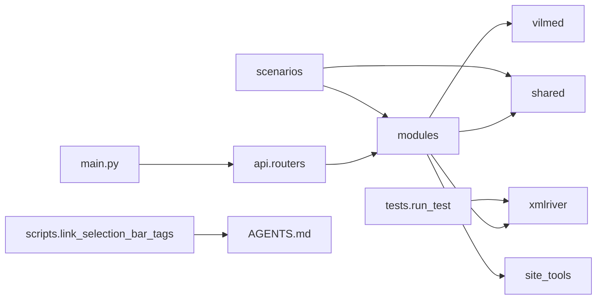

<!-- workai:plan:update -->

## План: Структура модулей и правила проекта

Разложить код по общим и сервисным пакетам, разделить приложение и API, а ручной XMLRiver-запуск с файлом фраз перенести в `tests/`. Расширить `AGENTS.md`, используя `link_selection_bar_tags.py` как пример подробного описания этапов, но не как буквальный эталон формата принтов: в нём есть расхождения с уже заданными проектными правилами.

### Проблема

Сейчас `main_test.py` совмещает создание приложения, endpoints и запуск Uvicorn ([создание приложения](main_test.py#L19-L20), [маршруты](main_test.py#L29-L42), [запуск](main_test.py#L392)). XMLRiver-маршруты находятся отдельно в `xmlriver/web.py` и напрямую используют как код XMLRiver, так и утилиты из `scripts` ([импорты](xmlriver/web.py#L13-L18), [маршруты](xmlriver/web.py#L118-L170)).

В [link_selection_bar_tags.py](scripts/link_selection_bar_tags.py#L183-L240) подробно описаны этапы обработки данных, а основная функция делит процесс на четыре шага ([описание процесса](scripts/link_selection_bar_tags.py#L525-L567)). Это полезный пример того, насколько ясно описывать назначение функций и этапы. Однако формат принтов в файле неоднороден: например, используются emoji и метки `[START]` ([начало процесса](scripts/link_selection_bar_tags.py#L536-L552)), нет `flush=True`, а отдельные сообщения выводят текст слова или часть URL ([обработка слова](scripts/link_selection_bar_tags.py#L63), [запрос страницы](scripts/link_selection_bar_tags.py#L79)). Поэтому подробность комментариев и стадий стоит взять за образец, а формат сообщений — сверять с действующим стандартом в `AGENTS.md`.

### Связанные файлы

- [AGENTS.md](AGENTS.md) — дополнить существующие правила структуры проекта, повторного использования и оформления кода.
- [scripts/link_selection_bar_tags.py](scripts/link_selection_bar_tags.py#L183-L240), [scripts/link_selection_bar_tags.py](scripts/link_selection_bar_tags.py#L525-L567) — использовать для анализа детализации функций и описания этапов.
- [main_test.py](main_test.py#L19-L20) — разделить создание приложения и endpoints.
- [xmlriver/web.py](xmlriver/web.py#L13-L18) — перенести маршруты в API-пакет.
- [xmlriver/input.py](xmlriver/input.py#L14-L59), [xmlriver/export.py](xmlriver/export.py#L35-L94), [xmlriver/registry.py](xmlriver/registry.py#L8-L38), [xmlriver/service.py](xmlriver/service.py#L7-L53) — выделить общий импорт фраз и сохранить XMLRiver-логику в сервисном пакете.
- [xmlriver/xmlriver_frequency.py](xmlriver/xmlriver_frequency.py), [xmlriver/xmlriver_popular.py](xmlriver/xmlriver_popular.py), [xmlriver/xmlriver_serp.py](xmlriver/xmlriver_serp.py), [xmlriver/xmlriver_config.py](xmlriver/xmlriver_config.py) — перенести и обновить внутренние импорты.
- [xmlriver/run_test.py](xmlriver/run_test.py), [xmlriver/phrases.xlsx](xmlriver/phrases.xlsx) — перенести в `tests/run_test.py` и `tests/phrases.xlsx`, настроив путь к файлу.
- [xmlriver/scenarios.py](xmlriver/scenarios.py#L1-L15) — сейчас содержит только пустой реестр сценариев.
- [scripts/live_log_stream.py](scripts/live_log_stream.py), [scripts/manage_temp_dir.py](scripts/manage_temp_dir.py), [scripts/check_links.py](scripts/check_links.py), [scripts/clear_directory.py](scripts/clear_directory.py), [scripts/open_list_links.py](scripts/open_list_links.py) — кандидаты на общий пакет.
- [scripts/update_cat_menu_vilmed.py](scripts/update_cat_menu_vilmed.py), [projects/vilmed/overspam_vilmed.py](projects/vilmed/overspam_vilmed.py), [scripts/link_selection_bar_tags.py](scripts/link_selection_bar_tags.py), [scripts/update_sheet_bar_tags.py](scripts/update_sheet_bar_tags.py) — разнести по доменным пакетам.
- [tests/test_xmlriver.py](tests/test_xmlriver.py#L16-L20) — обновить импорты и пути подмен.

### Поток

Предположение: сценарии могут объединять модули разных сервисов, поэтому их каталог размещается на верхнем уровне. `tests/run_test.py` остаётся ручным запуском и не входит в автоматический набор тестов.

**Шаги**
1. Создать пакеты `modules/xmlriver`, `modules/vilmed`, `modules/site_tools`, `shared`, `api/routers` и `scenarios`.
2. Перенести XMLRiver-клиенты и конфигурацию в `modules/xmlriver`, сохранив сервисные импорты и настройки.
3. Перенести `xmlriver/run_test.py` и `xmlriver/phrases.xlsx` в `tests/run_test.py` и `tests/phrases.xlsx`.
4. Настроить ручной запуск на чтение `tests/phrases.xlsx`, не включая скрипт в автоматический набор тестов.
5. Перенести XMLRiver `registry`, `service` и `export` в `modules/xmlriver`, а общий парсер фраз разместить в `shared/phrase_import.py`.
6. Перенести общие инфраструктурные утилиты из `scripts` в корневой пакет `shared`.
7. Перенести задачи Vilmed в `modules/vilmed`, а обработчики bar tags — в `modules/site_tools`.
8. Разнести endpoints из `main_test.py` и `xmlriver/web.py` по роутерам в `api/routers`.
9. Переименовать `main_test.py` в `main.py`, обновить импорты и существующие тесты.
10. Дополнить `AGENTS.md` правилами структуры, именования и повторного использования, разобрав `link_selection_bar_tags.py` как пример подробной документации этапов.
11. Зафиксировать в `AGENTS.md`, что сообщения `link_selection_bar_tags.py` не следует копировать как буквальный стандарт; для новых и изменяемых принтов применять единый формат проекта и не выводить содержимое фраз или URL.

**Проверка**
1. Запустить `python tests/run_test.py` и проверить, что скрипт читает `tests/phrases.xlsx`.
2. Запустить `python -m unittest discover -s tests` и убедиться, что ручной запуск не выполняется автоматически.
3. Запустить `uvicorn main:app` и проверить главную страницу и используемые endpoints.
4. Проверить, что новые правила явно отделяют образец комментариев и стадий от обязательного формата принтов.

**Решения**
- В инструкции описывать каждую новую функцию так, чтобы были ясны её назначение, входные данные, результат и важные этапы; отдельно пояснять причины нетривиальных проверок и ограничений. Для очевидных строк комментарии не требовать.
- Для принтов сохранить уже зафиксированный в `AGENTS.md` стандарт `[MODULE][STAGE][STATUS] Message`, стабильные идентификаторы и `flush=True`; избегать emoji в статусах и содержимого фраз или URL, если достаточно сообщить этап и счётчики.
- `input.py` можно вынести в `shared/`: разбор текста и XLSX не связан с вызовами XMLRiver. Имя `import.py` не использовать, так как `import` — ключевое слово Python; `phrase_import.py` точнее, чем `input.py`.
- `registry.py` регистрирует функции XMLRiver, `service.py` использует настройки сервиса, а `export.py` формирует отчёты по его схемам. Переносить их в `shared/` сейчас означало бы создать ложную универсальность.
- Для настроек избегать нескольких неоднозначных файлов `config.py`: общие настройки приложения и настройки конкретного сервиса должны иметь понятное место и контекст, например `modules/xmlriver/settings.py`.
- При переносе перепроверить пути: `overspam_vilmed.py` вычисляет корень проекта относительно своего расположения ([расчёт путей](projects/vilmed/overspam_vilmed.py#L6-L15)), а конфигурация XMLRiver ищет XLSX рядом с собой ([путь к файлу](xmlriver/xmlriver_config.py#L10-L14)). Незакоммиченные изменения в затрагиваемых файлах необходимо сохранить.