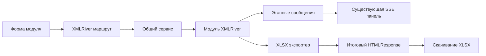

<!-- workai:plan:update -->

## План: XMLRiver в карточке главной страницы

На главной странице появится карточка XMLRiver с тремя вкладками, загрузкой фраз файлом или через textarea и скачиванием результата в XLSX. Прогресс будет виден по этапам через существующий поток логов; `HTMLResponse` вернёт итоговый статус и ссылку на файл. Также будут закреплены правила оформления кода и применены к XMLRiver-модулям.

### Проблема

Существующие маршруты уже возвращают HTML-фрагменты, а приложение поддерживает потоковые логи через SSE. Чтобы видеть ход работы до завершения запроса, одного итогового `HTMLResponse` недостаточно: нужно также добавить новые маршруты в список наблюдаемых форм и печатать этапы обработки. В качестве образца для именования этапов можно использовать сообщения `link_selection_bar_tags` ([`main_test.py`, стр. 42–49 и 52–104](main_test.py#L42-L104), [`templates/dashboard.html`, стр. 298–326](templates/dashboard.html#L298-L326), [`scripts/link_selection_bar_tags.py`, стр. 536–558](scripts/link_selection_bar_tags.py#L536-L558)).

### Связанные файлы

- [`AGENTS.md`](AGENTS.md) — создать правила проекта для подробных комментариев и единообразных этапных сообщений.
- [`main_test.py`](main_test.py) — подключить маршруты модулей, прогресс-логирование и итоговые `HTMLResponse` со ссылкой на XLSX.
- [`templates/dashboard.html`](templates/dashboard.html) — добавить карточку XMLRiver с тремя вкладками, описаниями формата ввода и включить маршруты в наблюдение SSE.
- [`static/custom_styles.css`](static/custom_styles.css) — использовать существующий стиль карточек; дополнительные стили добавлять только при необходимости.
- [`scripts/link_selection_bar_tags.py`](scripts/link_selection_bar_tags.py) — использовать как образец формата этапных сообщений, не изменяя модуль.
- [`xmlriver/xmlriver_frequency.py`](xmlriver/xmlriver_frequency.py) — добавить комментарии и логи этапов сбора частотности.
- [`xmlriver/xmlriver_popular.py`](xmlriver/xmlriver_popular.py) — добавить комментарии и логи этапов сбора фраз.
- [`xmlriver/xmlriver_serp.py`](xmlriver/xmlriver_serp.py) — добавить комментарии и логи этапов сбора ТОП-конкурентов.
- [`xmlriver/run_test.py`](xmlriver/run_test.py) — сохранить как отдельный тестовый запуск из `phrases.xlsx`.
- [`config/config.py`](config/config.py) и [`xmlriver/config.py`](xmlriver/config.py) — использовать единый источник секретов и сохранить XMLRiver-специфичные настройки.
- [`.env.example`](.env.example) и [`.gitignore`](.gitignore) — описать только имена переменных и сохранить исключение локальных env-файлов.
- `xmlriver/registry.py` — описать доступные модули и их входы.
- `xmlriver/service.py` — проверять входы, вызывать функции и связывать их этапные сообщения с логированием.
- `xmlriver/export.py` — преобразовать результаты модулей в таблицы XLSX.
- `xmlriver/scenarios.py` — определить реестр будущих кодовых сценариев.
- `tests/test_xmlriver.py` — проверить ввод, этапы ответа и XLSX-экспорт без реальных API-запросов.

### Поток

Запрос из одной из вкладок запускает модуль через общий сервис. Этапы обработки идут в уже существующую SSE-панель, а по завершении форма получает `HTMLResponse` со статусом и ссылкой на XLSX.

**Шаги**
1. Создать `AGENTS.md` с правилами: комментировать этапы и важную логику, использовать единый формат сообщений `[МОДУЛЬ][ЭТАП][СТАТУС]`, не выводить секреты и содержимое учётных данных.
2. Централизовать чтение секретов в конфиге приложения, оставив параметры XMLRiver в `xmlriver/config.py`.
3. Создать реестр и общий сервис для запуска `frequency`, `popular` и `serp`.
4. Добавить в три XMLRiver-модуля подробные комментарии и сообщения о старте, ходе, успехе и ошибках по образцу этапных логов `link_selection_bar_tags`.
5. Добавить маршруты запуска, разбирающие либо textarea по строкам, либо XLSX с колонкой `phrase`, и создавать для каждого модуля XLSX-результат.
6. Вернуть через `HTMLResponse` сообщение о результате обработки и ссылку на скачивание, сохраняя файл во временной папке до отдачи.
7. Добавить в `dashboard.html` карточку XMLRiver с вкладками «Сбор частот», «Сбор фраз» и «ТОП конкурентов»; в каждой вкладке показать `div.alert alert-primary` с форматом ввода, а маршруты подключить к SSE-мониторингу.
8. Оставить `run_test.py` отдельным тестовым запуском из `phrases.xlsx` и добавить тесты маршрутов, этапного логирования и XLSX-файлов.

**Проверка**
1. `python -m unittest discover -s tests`
2. `python -m compileall -q main_test.py config xmlriver`
3. Для каждого модуля проверить ввод фраз через textarea и XLSX с заголовком `phrase`.
4. Убедиться, что во время выполнения этапы появляются в SSE-панели, а после завершения `HTMLResponse` содержит ссылку на корректный XLSX.
5. Проверить, что ошибки отражены в HTML-ответе или XLSX, а секреты не попадают в логи и ответы.

**Решения**
- Файл для веб-интерфейса — XLSX с колонкой `phrase`; альтернативный ввод — одна фраза на строку в textarea. За один запуск используется только один источник.
- `run_test.py` остаётся самостоятельным скриптом и продолжает читать `phrases.xlsx`.
- `HTMLResponse` используется для ответа формы после обработки; для отображения прогресса во время выполнения используется существующий SSE-поток, поскольку обычный `HTMLResponse` отправляется только после завершения запроса.
- Карточка оформляется существующими Bootstrap-компонентами; отдельная страница не создаётся.

**Риски**
- Если оба источника фраз переданы одновременно или в XLSX отсутствует колонка `phrase`, маршрут должен вернуть понятную ошибку до обращения к API.
- Вызовы API могут быть долгими; прогресс-сообщения не должны содержать ключи или полные URL с параметрами авторизации.